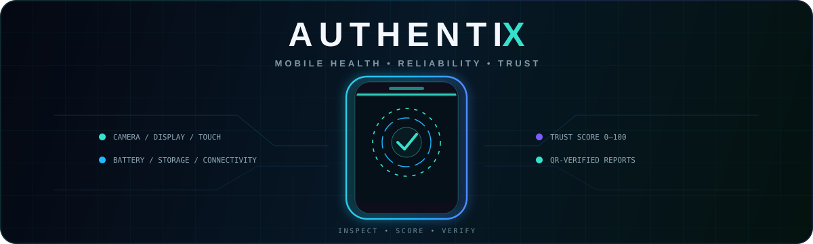
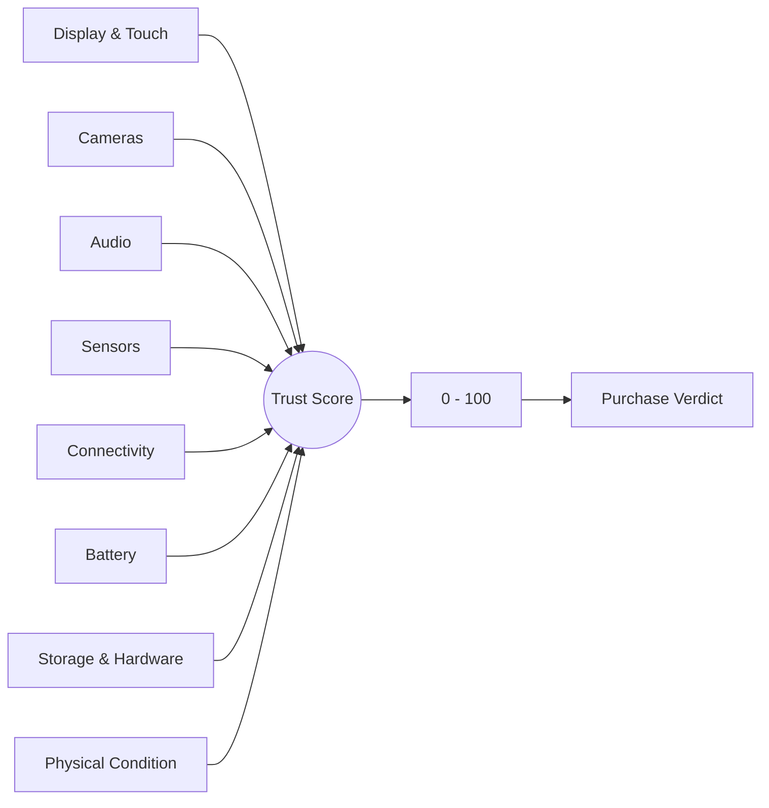
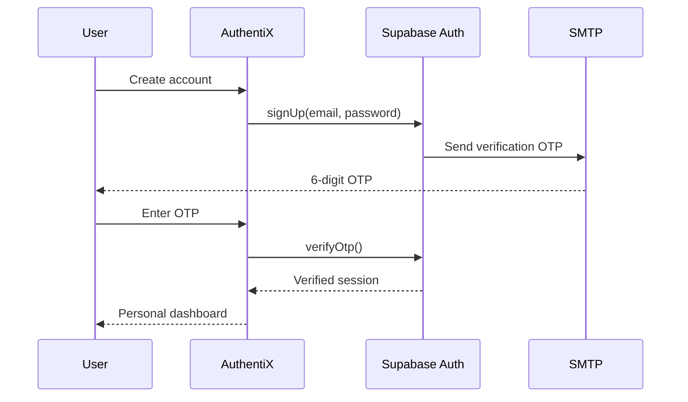
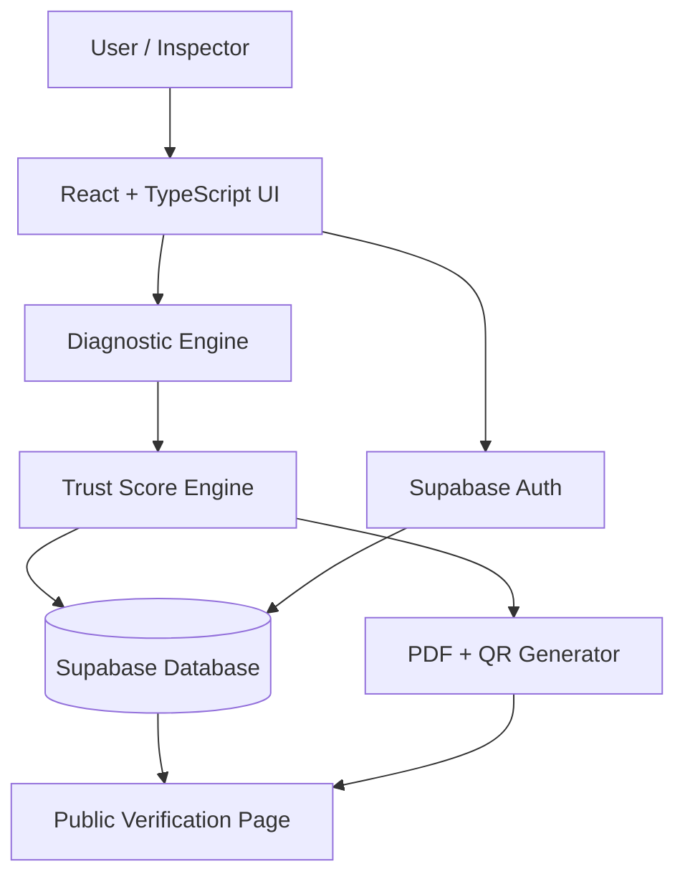

<div align="center">



<br/>

# `AuthentiX`

### Portable Android Mobile Health & Reliability Analyzer

**Inspect deeper. Score smarter. Verify what you buy.**

<br/>

[](https://authentix-mobile.vercel.app/)
[](https://react.dev/)
[](https://www.typescriptlang.org/)
[](https://supabase.com/)
[](https://vite.dev/)

<br/>

> **A second-hand phone can look perfect and still hide problems.**  
> AuthentiX turns a scattered manual inspection into a guided diagnostic journey, combines the results into a **0–100 Trust Score**, and produces a **QR-verifiable inspection report**.

</div>

---

## ✦ The idea

Buying a used smartphone is usually based on three things: how the device looks, what the seller says, and a few quick manual checks. That is not enough to expose many reliability issues.

**AuthentiX** was built around a simple question:

> **What if a buyer could run one guided inspection and leave with a clear, shareable device-health result?**

The project brings device information, interactive hardware checks, connectivity tests, physical inspection, score generation, report history, and public QR verification into one experience.

```text
              ┌──────────────────────────────┐
              │      SECOND-HAND PHONE       │
              └──────────────┬───────────────┘
                             │
                             ▼
                 ╭────────────────────╮
                 │   AUTHENTIX SCAN   │
                 ╰────────────────────╯
                    ╱       │       ╲
                   ╱        │        ╲
                  ▼         ▼         ▼
             HARDWARE    SENSORS   CONDITION
                  ╲         │         ╱
                   ╲        │        ╱
                    ▼       ▼       ▼
                 ╭────────────────────╮
                 │   TRUST SCORE      │
                 │      0 — 100       │
                 ╰─────────┬──────────╯
                           │
                           ▼
                 QR-VERIFIED REPORT
```

---

## ⚡ What makes AuthentiX different?

<table>
<tr>
<td width="50%" valign="top">

### ◈ Guided inspection
Instead of throwing raw technical values at the user, AuthentiX walks through the device **one test at a time** with a clear PASS / WARNING / FAIL / UNSUPPORTED result.

</td>
<td width="50%" valign="top">

### ◈ Trust Score
Individual checks are grouped into weighted diagnostic categories and transformed into a single **0–100 device-health score** for easier decision-making.

</td>
</tr>
<tr>
<td width="50%" valign="top">

### ◈ Real interactive tests
The experience includes live browser-accessible hardware interactions such as **camera preview, photo capture, microphone input, display patterns, touch coverage, location, motion, vibration, network and more**.

</td>
<td width="50%" valign="top">

### ◈ QR-verifiable reports
Each generated report can include a QR code. Scanning it opens a public verification page containing the inspection summary, test results, Trust Score, condition breakdown, warnings and recommendations.

</td>
</tr>
</table>

---

## 🧪 16-point diagnostic journey

<div align="center">

| # | Diagnostic | # | Diagnostic |
|---:|---|---:|---|
| `01` | 📱 Device Information | `09` | 💾 Storage Capability |
| `02` | 🖥️ Display Test | `10` | 🌐 Internet / Network |
| `03` | 👆 Touch Screen Test | `11` | 🔵 Bluetooth Capability |
| `04` | 🤳 Front Camera | `12` | 📍 GPS / Location |
| `05` | 📷 Rear Camera | `13` | 🧭 Motion & Orientation |
| `06` | 🎙️ Microphone | `14` | 🔋 Battery / Charging |
| `07` | 🔊 Speaker / Audio | `15` | 🧠 Hardware Capability |
| `08` | 📳 Vibration | `16` | 🛠️ Physical Condition |

</div>

The system then moves to **Review → Trust Score → Report Generation → QR Verification**.

---

## 🧠 Trust Score engine

AuthentiX does not treat every test equally. Results are grouped into diagnostic categories and processed using a weighted scoring approach.



Typical interpretation:

| Score | Condition | Meaning |
|---:|---|---|
| `90–100` | 🟢 Excellent | Strong overall diagnostic health |
| `75–89` | 🔵 Good | Generally healthy; review minor warnings |
| `60–74` | 🟠 Inspect | Additional inspection recommended |
| `< 60` | 🔴 High Risk | Repair / professional inspection advised |

> The Trust Score is a **decision-support indicator**, not a manufacturer authenticity certificate or a guarantee that no hidden defect exists.

---

## 🔐 Authentication & user isolation

AuthentiX uses **Supabase Authentication** for account registration, email OTP verification, login and user-specific inspection history.



Each signed-in user sees only their own inspection history in the application.

---

## 📍 Location-aware GPS test

When location permission is granted, the GPS module can display the **current browser/device position**, including:

- Latitude
- Longitude
- Reported GPS accuracy
- A direct link to open the location in Maps

For privacy, the **public QR report does not expose exact coordinates**. It can show that the GPS test succeeded and the measured accuracy without publishing the user's precise position.

---

## 📷 Camera diagnostics

Both camera stages support an interactive workflow:

```text
START CAMERA
     ↓
LIVE PREVIEW
     ↓
CAPTURE TEST PHOTO
     ↓
FROZEN CAPTURE
  ↙       ↘
RETRY     ASSESS
PHOTO     RESULT
```

The front camera preview is handled appropriately for selfie orientation, while the rear camera uses the environment-facing camera where supported by the browser/device.

---

## 🧾 Reports that can be verified

A completed inspection generates a structured report containing:

- Device information
- Overall Trust Score
- Category score breakdown
- Individual diagnostic results
- PASS / WARNING / FAIL / UNSUPPORTED totals
- Physical condition checklist
- Warnings and irregularities
- Recommendations
- Inspection timestamp
- Public report verification ID

PDF export is generated with **jsPDF + AutoTable**, and QR codes are generated using the **qrcode** package.

```text
AUTHENTIX REPORT
│
├── Device Identity
├── Trust Score
├── Category Breakdown
├── 16 Diagnostic Results
├── Physical Inspection
├── Warnings
├── Recommendations
└── QR ───────► Public Verification Page
```

---

## 🧬 System architecture



---

## 🛠️ Technology stack

<div align="center">

| Layer | Technology |
|---|---|
| Frontend | React 18 + TypeScript |
| Build Tool | Vite 6 |
| Styling | Tailwind CSS |
| Motion | Framer Motion |
| Icons | Lucide React |
| 3D / Visuals | Three.js + React Three Fiber + Drei |
| Authentication | Supabase Auth |
| Database | Supabase PostgreSQL |
| PDF Reports | jsPDF + jsPDF-AutoTable |
| QR Codes | qrcode |
| Deployment | Vercel |

</div>

---

## 🚀 Run AuthentiX locally

### 1. Clone the repository

```bash
git clone https://github.com/syedsufiyaan-dot/authentix.git
cd authentix
```

### 2. Install dependencies

```bash
npm install
```

### 3. Create your environment file

Create `.env` in the project root:

```env
VITE_SUPABASE_URL=your_supabase_project_url
VITE_SUPABASE_ANON_KEY=your_supabase_anon_key
```

> Never commit private SMTP passwords, service-role keys, or secret API credentials to the repository.

### 4. Start development mode

```bash
npm run dev
```

### 5. Production build

```bash
npm run build
```

---

## 🗃️ Backend data model

AuthentiX stores completed inspections in Supabase and keeps detailed test-level results associated with each diagnostic session.

```text
diagnostic_sessions
├── user_id
├── report_code
├── device_name
├── manufacturer
├── operating_system
├── trust_score
├── report_data
├── status
└── completed_at

        │ 1
        │
        │ many
        ▼

diagnostic_results
├── session_id
├── test_name
├── category
├── status
├── score
└── details
```

---

## 🎯 Design philosophy

AuthentiX is built around four principles:

**01 — Technical honesty**  
If the browser cannot reliably access a hardware value, the system marks it as unsupported rather than inventing a result.

**02 — Human-readable diagnostics**  
The interface translates technical checks into results that a normal second-hand phone buyer can understand.

**03 — Traceable reports**  
A result should not end at the screen. It should be shareable, reviewable and verifiable later.

**04 — Modular growth**  
Every diagnostic is treated as a module so the system can evolve from a browser prototype toward deeper native / embedded-device inspection.

---

## 🛰️ Roadmap

```text
NOW                                          NEXT
│                                             │
├─ Interactive browser diagnostics            ├─ Raspberry Pi diagnostic bridge
├─ Supabase OTP authentication                 ├─ Android ADB integration
├─ User-specific inspection history            ├─ Deeper battery-health metrics
├─ Trust Score engine                          ├─ Native storage diagnostics
├─ PDF report generation                       ├─ Extended device-model support
├─ QR report verification                      ├─ Data-driven / ML score refinement
└─ Current-location GPS validation             └─ Technician / marketplace workflows
```

The long-term vision is to combine the current web experience with **Raspberry Pi + Android Debug Bridge (ADB)** based diagnostics for deeper device-level measurements that browsers cannot expose safely.

---

## ⚠️ Technical scope

The current repository is a **web-based AuthentiX prototype**. Modern browsers intentionally restrict access to sensitive device information such as IMEI, internal battery cycle count, low-level storage wear and certain hardware identifiers.

AuthentiX therefore separates:

- **real browser-accessible measurements**, which are tested directly;
- **interactive user-confirmed checks**, such as display clarity and physical condition;
- **unsupported native-level measurements**, which are clearly labelled instead of simulated as genuine values.

This approach keeps the project useful without overstating what a web application can technically prove.

---

## 👥 Team AuthentiX

<div align="center">

| Team Member | Project Contribution Area |
|---|---|
| **Syed Sufiyaan Ahmed S** | System design, integration, Android / diagnostic workflow |
| **Syed Javeed Ahmed N** | Software modules, Trust Score, report workflow |
| **Muhammad Safik M** | Hardware diagnostics, component testing, result verification |
| **Selvakumar R** | Storage / connectivity testing, analysis, documentation support |

</div>

---

## 🌐 Live project

<div align="center">

### **Try AuthentiX**

[](https://authentix-mobile.vercel.app/)

`https://authentix-mobile.vercel.app/`

<br/>

**Know the device. Trust the decision.**

<br/>


</div>
